# Inventory & Demand Planning Control Tower: Wide World Importers

> End-to-end planning case study: SQL Server data warehouse (bronze → silver → gold), statistical forecasting, an inventory-policy simulation in T-SQL, robustness checks, and an 8-page Power BI report, built on Microsoft's WideWorldImporters sample ERP database.
>
> Every number below comes from a query in this repo, and a full re-run of the pipeline from the source database reproduces every output exactly.

**Summary.** I audited the inventory-planning parameters of a wholesale distributor. Because the company's own stock records turned out to be unusable, I re-built inventory by simulating reorder-point policies day by day on real customer demand, calibrated on 2013-01 → 2015-05 and tested out-of-sample on 2015-06 → 2016-05. If the supplier lead times recorded on purchase orders are representative, re-planning with them cuts average inventory by **34% (95% CI −37% to −31%)** while slightly *raising* fill rate. Even under a far more conservative 7-day lead time the saving is **26%** at the same service level.

## Business questions

| # | Question | Who asks |
|---|----------|----------|
| Q1 | Which SKUs drive revenue and how predictable is their demand? (ABC-XYZ) | Demand Planner |
| Q2 | How accurate is a simple statistical forecast, and is it better than naive methods out of sample? (WAPE, bias) | S&OP meeting |
| Q3 | What safety stock / reorder point does each SKU need for a target service level, and what does it cost in average inventory? | Supply Planner / Inventory Analyst |
| Q4 | How much excess stock do the current planning parameters create? (declared vs recorded lead time, ERP reorder levels) | Inventory Analyst |
| Q5 | How well do we serve customers (on-time delivery, fill rate, backorders), and which SKUs drive the misses? | Customer Service / S&OP |
| Q6 | Can the source data be trusted? | Data Analyst |

> **Why simulate instead of reporting stock?** Profiling showed that WWI's sales data is realistic but its inventory and purchasing records are not: 99.98% of all stock receipts sit in 9 SKUs, 186 SKUs shipped more than 100× what they ever received, and 9 SKUs have negative implied opening stock. Historical stock levels are therefore treated as untrustworthy, and inventory is **simulated** from real daily demand under calculated policies. Details: [docs/data_profile.md](docs/data_profile.md).

## Architecture

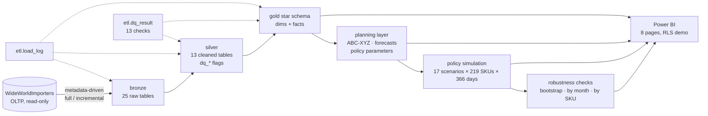

## What is built (SQL Server 2022, database `WWI_Analytics`)

| Layer | Objects | Notes |
|---|---|---|
| etl | `bronze_config`, `load_log`, `watermark`, `dq_result`, `usp_run_dq_checks`, `usp_run_pipeline`, `vw_pipeline_fingerprint`, `pipeline_fingerprint_snapshot` | metadata-driven loads, run log, 13 data-quality checks, reproducibility fingerprint |
| bronze | 25 raw tables via `bronze.usp_load_bronze` (full / incremental by `LastEditedWhen` or `ValidFrom`) | geography / binary columns skipped automatically |
| silver | 13 cleaned tables via `silver.usp_load_silver` | snake_case, typed, `dq_*` flags instead of deletes |
| gold – star | `dim_date`, `dim_stock_item`, `dim_customer`, `dim_supplier`, `dim_delivery_method`, `bridge_stock_item_group`, `fact_order_line`, `fact_invoice_line`, `fact_purchase_order_line`, `fact_demand_daily` (zero-filled SKU × day) | `gold.usp_load_gold` |
| gold – planning | `fact_demand_monthly`, `sku_classification` (ABC-XYZ), `seasonal_index`, `fact_forecast`, `forecast_model_selection`, `forecast_accuracy`, `dim_policy_scenario`, `normal_loss_table`, `policy_parameters`, `fact_policy_simulation` (1.36M rows) | `usp_build_demand_base`, `usp_build_forecast`, `usp_build_policy_parameters`, `usp_simulate_policy` |
| gold – robustness | `bootstrap_draws` (1,000 × 250 seeded draws), `robustness_result`, `vw_robustness_result`, `vw_forecast_accuracy_monthly`, `vw_policy_kpi_monthly` | `gold.usp_robustness_checks` |
| gold – views | `vw_policy_kpi_sku`, `vw_policy_kpi_scenario`, `vw_customer_service_monthly`, `vw_backorder_by_sku`, `vw_lead_time_audit`, `vw_pbi_stock_item` | feed Power BI |

Quality gates: 13 data-quality checks (all `error` checks = 0), 4 simulation invariants (stock balance, order pipeline, state, pack size: 0 violations over 3,723 scenario × SKU pairs), and a before/after fingerprint of 11 key outputs.

## How to reproduce

Requirements: SQL Server (built and tested on 2022 Developer, which is free), SSMS, and a recent Power BI Desktop that opens Power BI Project (.pbip / PBIR) files.

1. Download `WideWorldImporters-Full.bak` from the [official release](https://github.com/Microsoft/sql-server-samples/releases/tag/wide-world-importers-v1.0) and restore it: `sql/00_setup/000_restore_wwi.sql`.
2. Create the analytics database and schemas: `sql/00_setup/01_create_analytics_db.sql`. Optional: a least-privilege login (`03_create_etl_user.sql`, set your own password) and the Row-Level Security grant that makes customers visible (`05_grant_customer_rls_access.sql`).
3. Create the objects, in folder order: `sql/01_bronze/*`, `sql/02_silver/*`, `sql/03_gold/*`, `sql/04_analysis/01…07`, `sql/05_quality_checks/*`, `sql/06_powerbi/*`, `sql/99_usp_run_pipeline.sql`.
4. Run everything: `EXEC etl.usp_run_pipeline @bronze_mode = 'full';` (≈4 min, mostly the simulation).
5. Check: `SELECT * FROM etl.dq_result WHERE run_id = (SELECT MAX(run_id) FROM etl.dq_result);`, run `sql/05_quality_checks/02_simulation_invariants.sql` (all zeros), and compare `SELECT * FROM etl.vw_pipeline_fingerprint;` with the expected values in [docs/data_catalog.md](docs/data_catalog.md#expected-pipeline-fingerprint).
6. Open `powerbi/WWI_Planning.pbip`, set the SQL Server data source to your server if it is not `localhost`, and refresh. (`powerbi/WWI_Planning.pbix` contains the same report with data, for viewing without SQL Server.)

Verified: a full re-run from the source database reproduced all 11 fingerprinted outputs exactly (row counts and totals, from 231,412 order lines to 1,362,618 simulated SKU-days).

## Policy simulation design
- Calibrate on 2013-01 → 2015-05, simulate out-of-sample on 2015-06 → 2016-05 with actual daily demand.
- Parameters are re-derived every month from data before that month: SEAS forecast (μ), daily demand noise (σ_d), relative forecast error (e_rel); σ_LT = √(LT·σ_d² + (LT·μ_d·e_rel)²).
- Reorder point + order-up-to policy, orders rounded to the supplier pack size (QuantityPerOuter), backorders allowed.
- Scenario sweep (17): cycle service level {90, 95, 97.5, 99%} × lead time {declared per SKU, 7 d, 3 d = max recorded} + the ERP's current parameters + fill-rate-targeted safety stock (normal loss function) {95, 97.5, 99, 99.5%} at 3 d.
- T-SQL day-by-day loop, set-based across all SKUs × scenarios.

## Power BI report
Saved as a **Power BI Project** (`powerbi/WWI_Planning.pbip`, PBIR + TMDL text files, diff-able in Git) plus a `.pbix` copy with data. The report pages are generated from a spec by [`powerbi/build_report.py`](powerbi/build_report.py); model, relationships and DAX: [docs/powerbi_model.md](docs/powerbi_model.md), [powerbi/measures.dax](powerbi/measures.dax).
Model: 20 tables, 19 relationships, 25 DAX measures (incl. same-period YoY that handles the partial year 2016), what-if service-level parameter, a drill-through page, and an RLS role (`Clothing planner` sees 74 of 227 SKUs).

| | |
|---|---|
| **1 · S&OP overview** 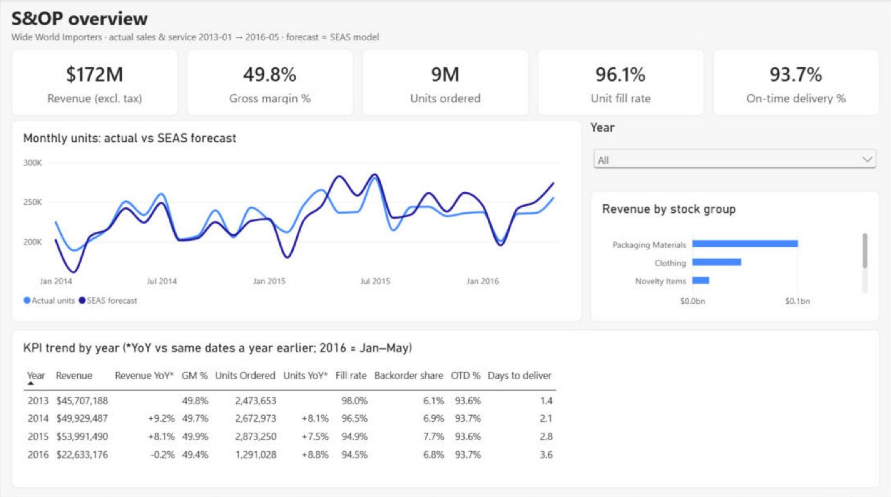 | **2 · Demand & forecast** 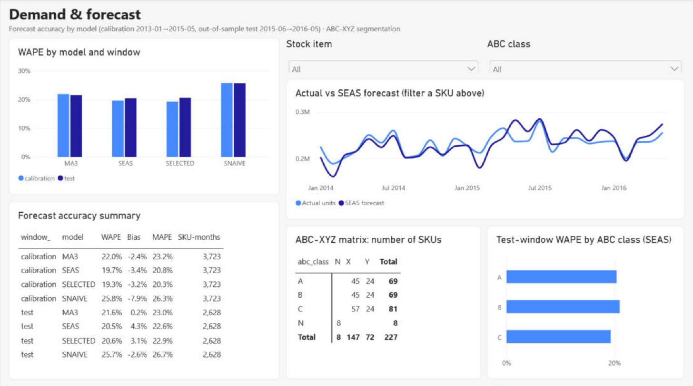 |
| **3 · Policy simulation** 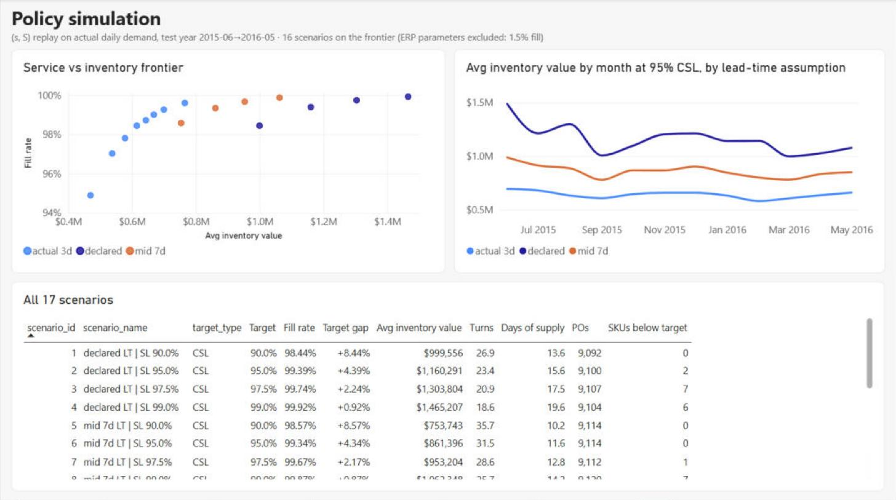 | **4 · Planning-parameter audit** 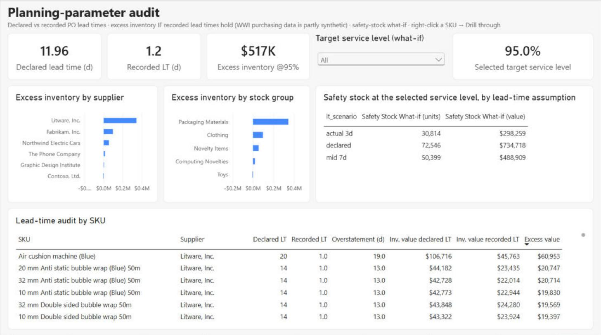 |
| **5 · Customer service** 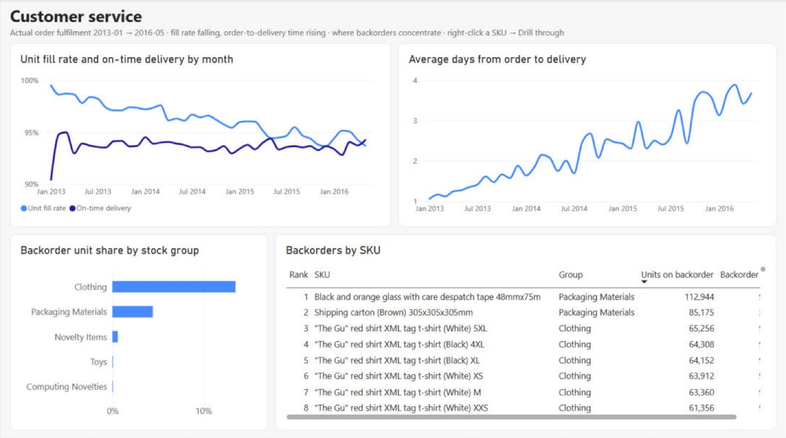 | **6 · Data quality & ETL** 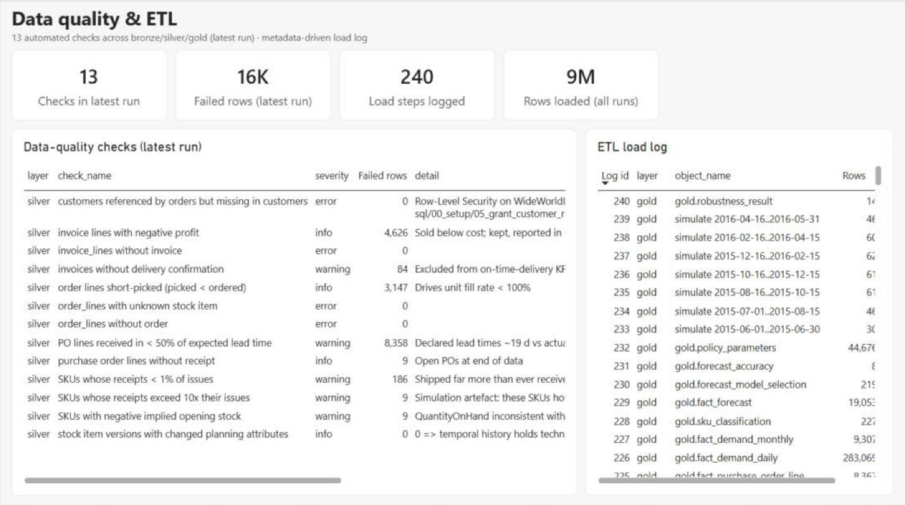 |
| **7 · Robustness checks** 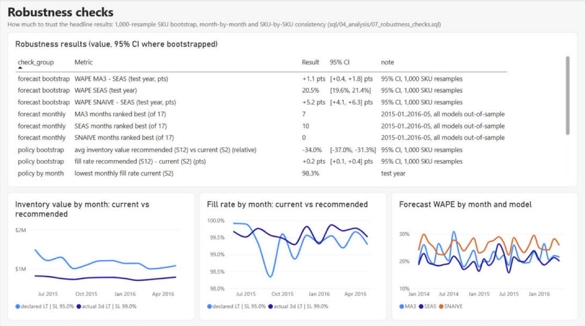 | **8 · SKU detail (drill-through)** 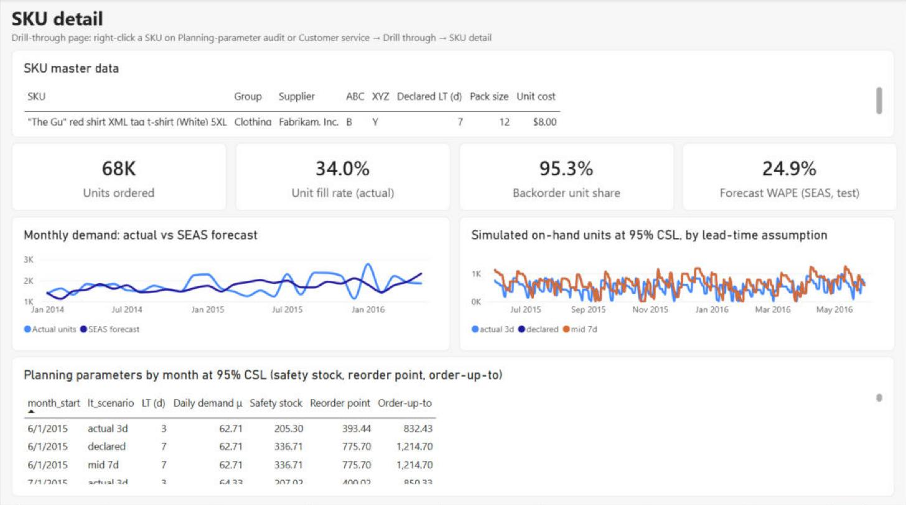 |

## Key findings (test year Jun-2015 → May-2016, out-of-sample)

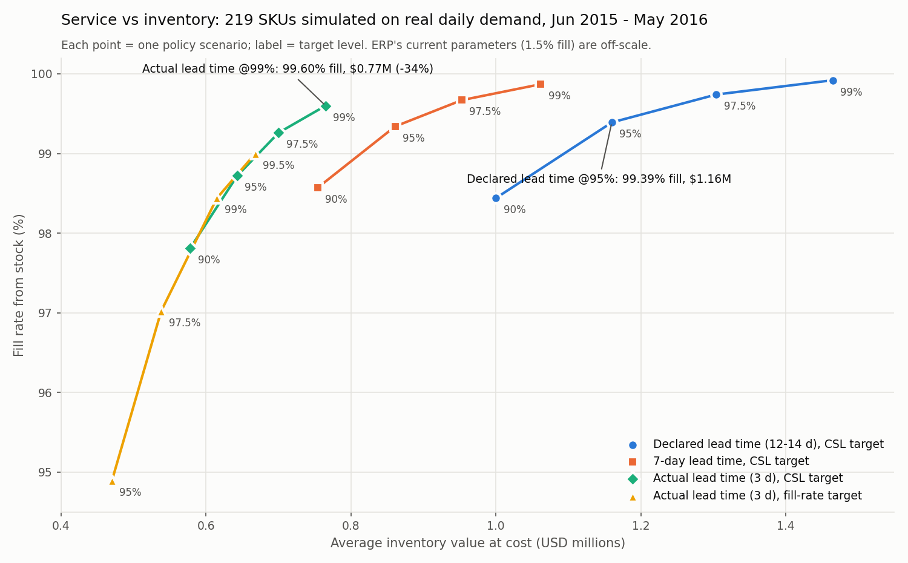

1. **Overstated lead times are the main driver of excess stock, under a clearly stated assumption.** SKUs carry a declared supplier lead time of ≈12 days on average, while purchase orders were received after ≈1.2 days. *If* those recorded lead times are representative, re-planning with them at a 99% target gives a **higher fill rate (99.60% vs 99.39%) with 34% less average inventory ($0.77M vs $1.16M at cost)** than the declared-lead-time policy at 95%; at the same 95% target the overstatement costs ≈ **$0.52M** of average inventory. Because WWI's purchasing data is partly synthetic, I also tested a deliberately conservative **7-day** lead time (≈6× the recorded average): the 95% policy still needs **26% less inventory ($0.86M vs $1.16M) at practically the same fill rate (99.34% vs 99.39%)**. The direction of the finding does not depend on the exact lead time.
2. **The ERP reorder levels are unusable.** WWI's stored ReorderLevel (5–20 units) and TargetStockLevel (40–200) against ~33 units/SKU/day of demand would fill only **~1.5%** of demand from stock.
3. **A simple seasonal model beats naive clearly, and a moving average narrowly.** Seasonal-index × trend forecast: **WAPE 20.5%** out-of-sample (95% CI 19.6–21.4%), **5.2 pts** better than seasonal-naive (CI +4.1 to +6.3) and **1.1 pts** better than a 3-month average (CI +0.4 to +1.8). Month by month the seasonal model wins 10 of 17 fully out-of-sample months, the moving average 7, so the edge over MA3 is real but small. Picking a "best" model per SKU looked better in-sample (19.3%) but not out-of-sample (20.6%): selection was fitting noise.
4. **Service is eroding as volume grows.** Units ordered grew 7.5–8.8% a year, but unit fill rate fell 98.0% → 94.5% (2013 → 2016) and order-to-delivery time rose 1.4 → 3.6 days. Backorders concentrate in Clothing (13.6% of units) and Packaging Materials (4.4%); one t-shirt SKU had a 34% fill rate. Also visible: Jan–May 2016 revenue was flat year-on-year (−0.2%) while units grew 9%, a price/mix question for the commercial team.

   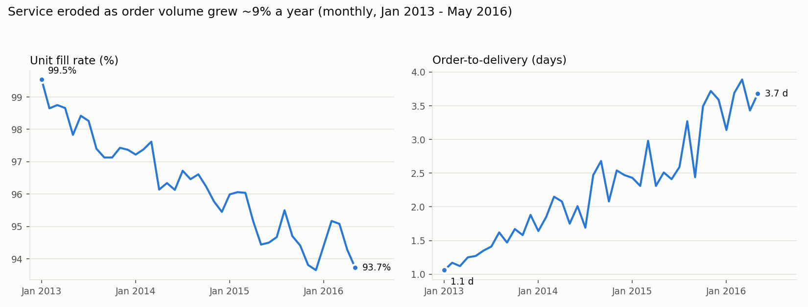

5. **Set safety stock for the KPI you manage.** z from a cycle-service-level target over-delivers on fill rate by 0.6–8.6 pts (90% target → 97.8% fill). Loss-function safety stock aimed at fill rate lands within 0.6 pt of target; for a 95% fill-rate goal it needs **$0.47M instead of $0.64M (−27%)**.

## How robust are these results?
Page 7 of the report and `gold.robustness_result` (procedure `gold.usp_robustness_checks`, re-run with the pipeline). "Recommended" = recorded 3-day lead time at 99% CSL; "current" = declared lead time at 95% CSL.

| Check | Result |
|---|---|
| Inventory, recommended vs current (SKU bootstrap, 1,000 resamples) | **−34.0%** [−37.0%, −31.3%] |
| Fill rate, recommended − current (SKU bootstrap) | **+0.2 pts** [+0.1, +0.4] |
| Months where recommended holds less inventory | **12 of 12** |
| Months where recommended fill rate ≥ current | 8 of 12 (worst month 99.3% vs 98.3%) |
| SKUs where recommended holds less inventory | **98.6%** of 219 |
| SKUs where recommended fill rate ≥ current | 63.0% of 219 |
| Forecast WAPE, SEAS (test year) | 20.5% [19.6%, 21.4%] |
| WAPE gap vs MA3 / vs seasonal-naive | +1.1 pts [+0.4, +1.8] / +5.2 pts [+4.1, +6.3] |

Reading: the inventory reduction is consistent across months and SKUs and its confidence interval is narrow; the fill-rate gain is small and not universal (37% of SKUs do slightly worse), so the defensible claim is "the same service with a third less stock", not "better service". The bootstrap resamples SKUs, so it captures uncertainty from the product mix but not from a different demand path; a Monte Carlo demand simulation would be the next step.

## From analysis to operations
How the result would be put to work in an ERP-run planning team (SAP terminology as the example):

1. **Fix master data first.** Update the planned delivery time (`PLIFZ`, material master MRP 2 view) from recorded receipts (e.g. the 90th percentile of the last 12 months per supplier × material) after the buyer confirms it with the supplier. This single field drives most of the excess inventory found here.
2. **Write the policy into the MRP fields.** Reorder-point planning (MRP type `VB`) with reorder point `MINBE` = μ·LT + SS, safety stock `EISBE` from the selected rule, lot size "replenish to maximum" (`HB`) with maximum stock `MABST` = the order-up-to level, rounding value `BSTRG` = supplier pack size. Mass update via `MM17` once the planning manager approves the list.
3. **Re-calculate on a cadence, not continuously.** Monthly or quarterly parameter review with the same SQL procedures; change only SKUs whose parameters move by more than a threshold, to avoid nervousness.
4. **Monitor and close the loop.** Track fill rate, target gap, days of supply and backorder share per SKU (pages 3, 5, 8). Phase the change in by ABC class (A items first, with a planner reviewing each), and compare actual service against the simulated expectation after one quarter.

## Assumptions & limitations
- WideWorldImporters is a synthetic sample; demand patterns are realistic, inventory and purchasing records are not (see "Why simulate"). Conclusions are about the method and the data as given, not about a real company.
- Inventory is simulated: single echelon, unlimited supplier capacity, backorders allowed, starting at the order-up-to level on 2015-06-01; costs use current `LastCostPrice`; no ordering or holding cost optimisation (service-level driven policies only).
- One demand path (the actual history) per scenario; robustness checks resample SKUs, not demand days.
- Safety stock uses a normal approximation: σ_LT = √(LT·σ_d² + (LT·μ_d·e_rel)²); lead time is treated as deterministic.
- Seasonal index estimated on 2013–2014, so the 2014 backtest has mild look-ahead in the index; months from 2015-01 (and the whole test year) have none.
- 8 SKUs launched in Jan 2016 have no history and are excluded from the statistical policy.

## Tech stack
SQL Server 2022 Developer · SSMS · T-SQL (CTEs, window functions, stored procedures, temporal tables, Row-Level Security) · Power BI Desktop (DAX, PBIR/TMDL project format, what-if parameter, drill-through, RLS) · Python (report generation, charts) · Git

## Repository structure
```
sql/00_setup          restore, profiling, analytics DB, least-privilege user, backup, RLS grant
sql/01_bronze         bronze_config + usp_load_bronze
sql/02_silver         usp_load_silver, load-log fix
sql/03_gold           usp_load_gold (star schema)
sql/04_analysis       demand base + ABC/XYZ, forecast, policy parameters, simulation, KPI views, robustness checks
sql/05_quality_checks usp_run_dq_checks, simulation invariants, pipeline fingerprint
sql/06_powerbi        view for the Power BI product dimension
sql/99_usp_run_pipeline.sql   end-to-end orchestration
powerbi/              WWI_Planning.pbip (+ .Report / .SemanticModel), WWI_Planning.pbix, build_report.py, measures.dax
images/               report screenshots and static charts (+ the scripts that draw the charts)
docs/                 data_profile, data_catalog, kpi_definitions, powerbi_model, diagrams
```

## Data source
Microsoft WideWorldImporters sample database (MIT license): https://learn.microsoft.com/en-us/sql/samples/wide-world-importers-what-is

## Note on tooling
This project was compiled with the help of an AI assistant (SQL, report-generation script and documentation), working under my direction: I chose the approach and the scenarios, reviewed the code, and validated the results; every figure was produced by running the code in this repo against the database.
